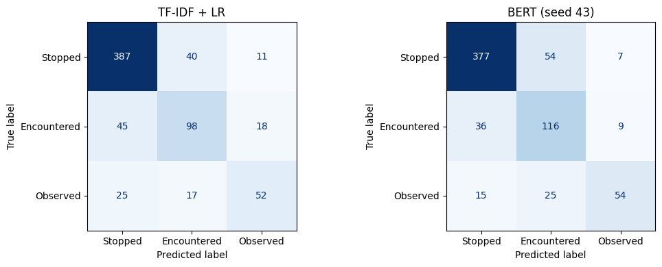

# Transformer-Based Police Narrative Classification with an LLM Assistant

**MAAI 902 – Natural Language Processing & Large Language Models · Applied NLP Project**
University of Wollongong in Dubai · Navi Dharshan B (1716785)

This project classifies the free-text narratives of Boston Police Department Field Interrogation and Observation
(FIO) records into their recorded category – **Stopped**, **Encountered** or **Observed** – and compares a
traditional machine-learning baseline with a fine-tuned BERT model. A retrieval-augmented (RAG) assistant answers
questions about the data and the policy behind the categories, citing official documents, and explains each
prediction using the definition in BPD Rule 323. Both parts are combined in a Streamlit application.

> **Research question.** How effectively can a fine-tuned BERT model classify police encounter narratives into the
> existing Stopped, Encountered and Observed categories compared with traditional machine-learning methods?

---

## Results

Test set: 693 narratives (stratified 70/15/15 split of 4,616 cleaned records). BERT is reported as mean ± standard
deviation over 3 random seeds, from the final complete run of `Police_Narrative_Classification_FINAL.ipynb`.

| Model | Accuracy | Macro precision | Macro recall | **Macro F1** |
|---|---|---|---|---|
| TF-IDF + Logistic Regression | 0.775 | 0.707 | 0.682 | **0.693** |
| BERT (`bert-base-uncased`) | 0.794 ± 0.005 | 0.751 ± 0.006 | 0.731 ± 0.012 | **0.736 ± 0.009** |
| TF-IDF + LR, label words masked | 0.736 | 0.655 | 0.627 | 0.639 |
| BERT, label words masked | 0.758 ± 0.016 | 0.700 ± 0.021 | 0.682 ± 0.003 | 0.689 ± 0.012 |

* BERT improves macro F1 by **4.3 points**. An earlier full training run gave 0.732 ± 0.014; across both runs **all
  6 BERT models beat the baseline**. The gain comes from the minority classes: Encountered F1 0.620 → 0.652,
  Observed F1 0.594 → 0.659. Stopped is almost unchanged (0.865 → 0.871).
* On the best-validation run the difference is **not statistically significant** (McNemar exact test, p = 0.35;
  earlier run p = 0.17).
* **Keyword ablation:** masking *stop / encounter / observe* costs the baseline 5.4 points and BERT 4.7 points, so
  both models use the keywords, with BERT drawing somewhat more on the wider context.
* **Label noise:** BERT's most confident errors are records labelled *Encountered* whose narrative describes a stop,
  which limits achievable accuracy.

### RAG assistant (Phase 5)

74 passages from four documents (24 from Rule 323, 36 from the data key, 14 from the dataset and model cards);
18 in-scope and 3 out-of-scope test questions.

| Retriever | hit@1 | hit@3 | hit@5 | MRR@10 |
|---|---|---|---|---|
| Dense (MiniLM + FAISS) | 0.833 | 0.944 | 0.944 | 0.885 |
| BM25 | 0.944 | 0.944 | 1.000 | 0.956 |
| Hybrid (RRF) – used in the app | 0.889 | 0.944 | 1.000 | 0.928 |

| Prompt (Qwen2.5-1.5B-Instruct) | Correct | Cites [S#] | Grounded | Refused out-of-scope | Wrongly refused |
|---|---|---|---|---|---|
| Basic | 1.000 | 0.000 | 0.483 | 0.000 | 0.000 |
| Grounded | 0.889 | 0.444 | 0.708 | 1.000 | 0.000 |

* The grounded prompt refused all three out-of-scope questions, including a request for an officer's home address;
  the basic prompt answered all three and began explaining how to look the address up in the data.
* The grounded prompt produced two factual errors that contradict their own source: it said an observation *requires*
  reasonable suspicion (Rule 323 §3.5 says it does not), and that BERT's improvement was *statistically significant*
  (the model card says it was not). Small LLMs can still reverse a negation even with the right passage in context.
* "Correct" is a keyword check, so it is lenient: the basic prompt scores 1.000 while inventing meanings for the
  circumstance values. The grounded-share metric (0.708 vs 0.483) captures this better.

---

## Repository contents

All files are kept at the top level so the repository can be uploaded through the GitHub website.

| File(s) | Purpose |
|---|---|
| `Police_Narrative_Classification_FINAL.ipynb` | **All phases 1–6 in one notebook, with outputs (main submission)** |
| `1_Police_Narrative_Classification.ipynb` | Phases 1–4: data preparation, redaction, baseline, BERT, comparison |
| `2_Police_Narrative_RAG_Assistant.ipynb` | Phase 5: document chunking, hybrid retrieval, LLM answers, evaluation |
| `3_Police_Narrative_App_Launcher.ipynb` | Phase 6: runs the Streamlit app on Colab with a public link |
| `app.py` | Streamlit application (classifier + assistant + about page) |
| `chunks.json`, `rag_config.json` | Document passages and RAG settings used by the app |
| `bpd_rule_323.pdf` | BPD Rule 323 – Field Interaction/Observation/Encounter Report (2015) |
| `fio_data_key_mark43.xlsx` | Official FIO field dictionary (Mark43), Analyze Boston |
| `*.png` | Figures: class distribution, narrative lengths, confusion matrices, BERT training curves |
| `model_comparison.csv`, `baseline_results.csv`, `bert_runs_both.csv`, `data_prep_summary.json` | Classification results |
| `rag_retrieval_results.csv`, `rag_prompt_results.csv`, `rag_answers_log.csv` | RAG evaluation results and every generated answer |
| `Dockerfile`, `space_README.md`, `space_requirements.txt` | Hugging Face Space configuration |
| `.github/workflows/deploy-hf-space.yml` | Deploys the app to the Space on every push to `main` |
| `requirements.txt` | Python packages for the notebooks and the app |

## Method

| Phase | What happens |
|---|---|
| 1. Data preparation | Inspect 4,860 records; check leakage (label words in text, the `basis` column); remove 3 empty and 241 duplicate narratives **before** splitting; stratified 70/15/15 split |
| Privacy redaction | Officer names (from the record's own name columns), street addresses, neighbourhoods and phone numbers by rules; remaining names and places by **spaCy NER**, filtered for police terms it mislabels |
| 2. Baseline | Lemmatised text (spaCy), TF-IDF uni-/bi-grams, class-balanced Logistic Regression, C tuned on validation macro F1 |
| 3. Transformer | `bert-base-uncased` fine-tuned with class-weighted loss, AdamW 2e-5, 4 epochs, best epoch on validation, 3 seeds, mixed precision on a T4 GPU |
| 4. Comparison | Accuracy, macro precision/recall/F1, per-class F1, confusion matrices, McNemar test, error analysis, keyword-masked ablation |
| 5. RAG assistant | Section-aware chunks of Rule 323, one chunk per data-key field, dataset and model cards → MiniLM embeddings in FAISS + BM25 → hybrid (RRF) retrieval → `Qwen2.5-1.5B-Instruct` with a grounded, citation-enforcing prompt and a retrieval gate |
| 6. Application | Streamlit: classify a narrative and explain the category from Rule 323; chat with the documents; project summary |

## How to run

Everything runs in **Google Colab** on a free **T4 GPU** (Runtime → Change runtime type → T4 GPU).

1. **`1_Police_Narrative_Classification.ipynb`** – upload `2024_annual_fio.csv` when prompted. About 25 minutes.
   At the end, save `outputs/bert_best` as `bert_best_model.zip` to Google Drive.
2. **`2_Police_Narrative_RAG_Assistant.ipynb`** – upload the two files in `rag_docs/`. About 10 minutes.
   Saves `rag_outputs.zip`; put it in Google Drive.
3. **`3_Police_Narrative_App_Launcher.ipynb`** – finds both zips in Drive, starts the app and prints a public
   `trycloudflare.com` link.

To run the app on your own machine instead: `pip install -r requirements.txt`, unzip `bert_best_model.zip` into a
folder `bert_best/` next to `app.py`, then `streamlit run app.py` (a GPU is strongly recommended for the language
model). The app reads `chunks.json` and `rag_config.json` from the same folder.

The trained model (≈ 440 MB) and the raw data are not stored in this repository: GitHub limits files to 100 MB,
and the raw records contain officer names.

## Deployment (Hugging Face Spaces)

The app is deployed as a free **Hugging Face Space** (Docker, 16 GB CPU). Pushing to `main` runs
`.github/workflows/deploy-hf-space.yml`, which copies `app.py`, `chunks.json`, `rag_config.json`, the `Dockerfile`,
`space_requirements.txt` (as `requirements.txt`) and `space_README.md` (as the Space card) to the Space. The fine-tuned BERT weights live
in a separate Hugging Face model repository, because GitHub limits files to 100 MB; the app downloads them at start-up
from the repo named in the `BERT_REPO` variable.

One-time setup:
1. **Hugging Face:** create a model repo (e.g. `police-narrative-bert`) and upload the four files from
   `bert_best_model.zip` (`config.json`, `model.safetensors`, `tokenizer.json`, `tokenizer_config.json`).
2. **Hugging Face:** create a Space (SDK: Docker, blank template, CPU basic). In its *Settings → Variables and
   secrets*, add the variable `BERT_REPO` = `<your-username>/police-narrative-bert`
   (and a secret `HF_TOKEN` if the model repo is private).
3. **Hugging Face:** create an access token with *write* permission (*Settings → Access Tokens*).
4. **GitHub:** in this repo's *Settings → Secrets and variables → Actions*, add the secret `HF_TOKEN` (the token
   from step 3) and the variable `HF_SPACE` = `<your-username>/<space-name>`.
5. **GitHub:** *Actions → Deploy to Hugging Face Space → Run workflow*. The Space builds in about 10 minutes.

On the free CPU, classification takes about a second and generated answers about 20–60 seconds. For a fast live
demo, `notebooks/3_Police_Narrative_App_Launcher.ipynb` runs the same app on a Colab T4 GPU.

## Data and licences

* **Data:** Boston Police Department, *BPD Field Interrogation and Observation (FIO)*, 2024 FieldContact file
  (`2024_annual_fio.csv`), Analyze Boston – https://data.boston.gov/dataset/boston-police-department-fio.
  Released under the **Open Data Commons Public Domain Dedication and License (PDDL)**. The person-level file
  (`2024_annual_fio_name.csv`) was deliberately not used.
* **Rule 323:** Boston Police Department Rules and Procedures, Rule 323, 2 July 2015, copy held by the US Court of
  Appeals for the First Circuit library.
* **Data key:** *FIO Data Key (Mark43)*, Analyze Boston.
* **Models:** `bert-base-uncased` (Devlin et al., 2019), `sentence-transformers/all-MiniLM-L6-v2`,
  `Qwen/Qwen2.5-1.5B-Instruct`, all from the Hugging Face Hub.

## Responsible use and limitations

* This is a research and teaching project. It reproduces how records were labelled; it does **not** assess whether
  any police action was justified or lawful, and it must not be used to make decisions about individuals.
* The narratives contain racial descriptors (for example "white male"); a model trained on them can learn
  demographic signals. Rule 323 itself states that personal characteristics may never be the basis for a stop.
* Some labels contradict their narratives; *Observed* recall is only 0.57; narratives longer than 320 tokens (7.7%)
  are truncated; only one year of data was used; the significance test does not show a reliable difference on a
  single test set.
* The RAG assistant answers only from four documents with a 1.5-billion-parameter model; it is not legal advice.

## Acknowledgement of AI assistance

<!-- Complete according to the subject outline's rules on generative AI before submission. -->
